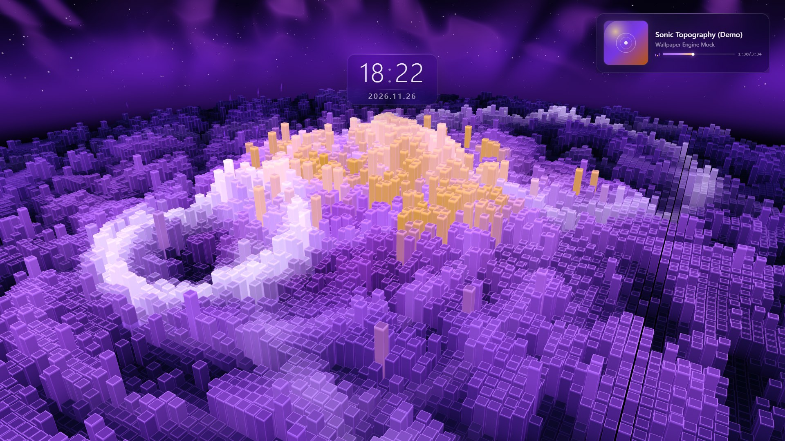
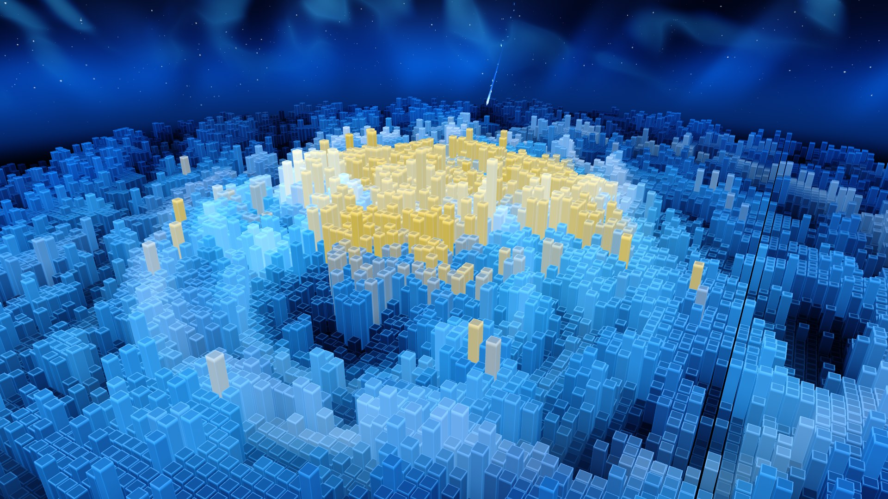
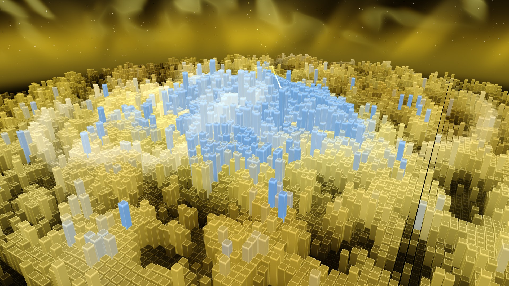
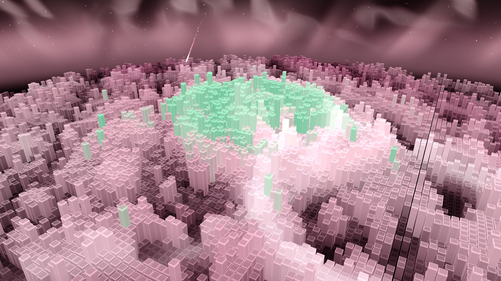
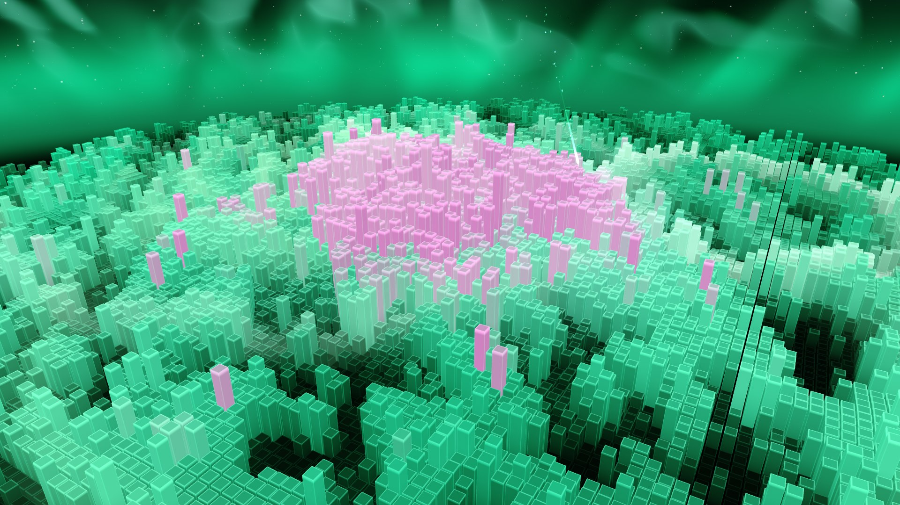
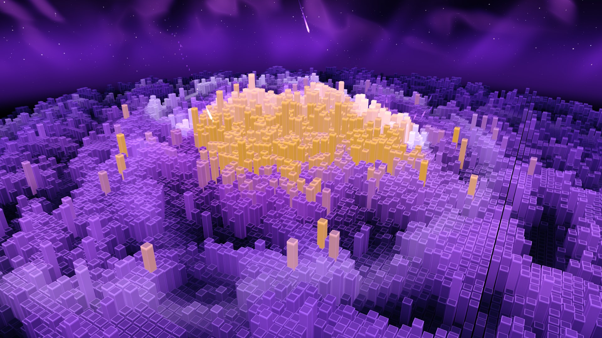
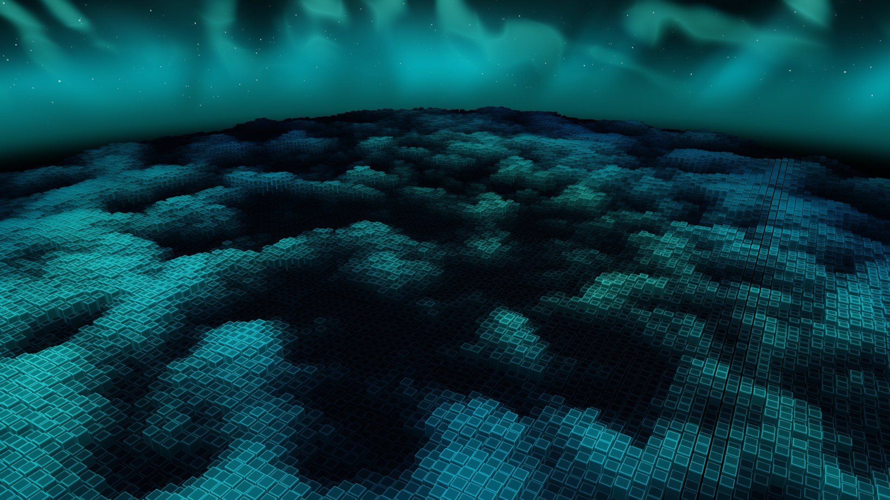
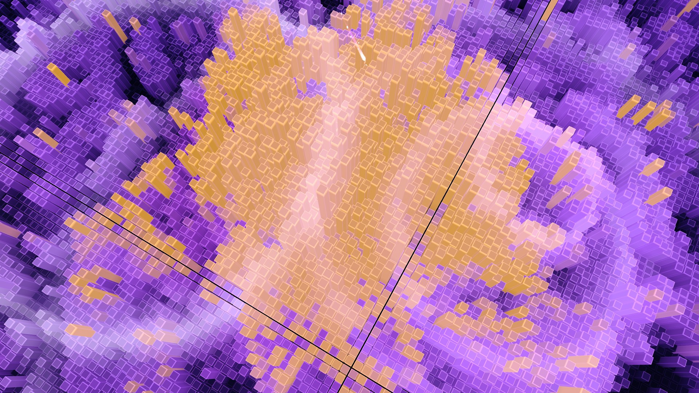

# 音域回响 · Sonic Topography

> A 3D audio-reactive topography wallpaper for Wallpaper Engine powered by React 19, Three.js, React Three Fiber, and custom GLSL3 shaders.

[](./LICENSE)
[](https://www.wallpaperengine.io/)
[](https://react.dev/)
[](https://threejs.org/)



音乐实时驱动一片由数千至百万级方柱构成的 3D 地形：超低频与低频在中心推起起伏山峦，中频铺开对角线流动的河流纹理，高频散点在边缘跃动；节拍命中的双谐波波纹从落点扩散，高空等离子彗星划破星空并溅射余烬火花与地面冲击波光环。画面上方悬浮可定制毛玻璃时钟，右上角集成实时媒体信息卡片，背景为随主题变色的银河、极光与三层视差星空穹顶。

> **衍生开发声明**：本项目基于 [CmzYa/sonic-topography](https://github.com/CmzYa/sonic-topography)（GPL-3.0）进行二次开发，并作了大量重构与功能增强。

---

## 目录

- [特性](#特性)
- [效果展示](#效果展示)
- [与上游的主要差异](#与上游的主要差异)
- [快速开始](#快速开始)
- [配置项](#配置项)
- [频段映射](#频段映射)
- [项目结构](#项目结构)
- [技术栈与开发说明](#技术栈与开发说明)
- [开源许可与致谢](#开源许可与致谢)

---

## 特性

- **3D 音域方柱地形**：圆形盘阵由去除不可见底面的 5 面方柱构成（20 顶点/柱），支持 `120×120` ~ `1080×1080` 多档渲染精度（`wallpaper/project.json` 默认 `120×120`，源码 schema 兜底默认 `160×160`），内置 ACES 柔和色调滚降、IGN 8-bit 去色带抖动、高柱强调色及可调低柱压暗强度（`lowPillarDim`）。
- **立体声 64-bin 音频分析与 AGC**：正确解析 Wallpaper Engine 128-bin 立体声布局（`[0..63]` 左声道 + `[64..127]` 右声道）合并为 64-bin 频谱并提取声像偏置 `stereoPan`；划分为 7 个非重叠感知频段（`subBass` / `bass` / `lowMid` / `mid` / `highMid` / `treble` / `air`，并兼容保留 `presence` / `brilliance`），结合慢追踪自动增益（AGC）、软拐点压缩与高频感知补偿、非对称快启慢落平滑以及新音频帧驱动更新（高刷屏零重复帧污染、静默短路、零分配复用）。
- **高性能 GPU 渲染管线**：
  - **WebGL2 半浮点 FBO 离屏高度场模拟**：`StaticPillarBakeMaterial` 在网格变更时一次性预烘焙静态噪声与几何属性，`HeightfieldSimMaterial` 每帧通过 MRT（`count=2`）对每根柱子仅计算一次高度（含 `uTreble` 外缘星光层）、峰值与波纹，消除逐顶点重复噪声与波纹计算（不支持半浮点 FBO 时自动无缝回退内联路径）。
  - **4×4 空间瓦片 + Early-Z**：地形按 `4×4` 空间分块并构建精确 `Box3`/`Sphere` 包围体，逐帧按相机距离从近到远排序 `renderOrder`（`10..25`），结合视锥剔除降低自遮挡过绘。
  - **16B 紧凑实例属性**：以 `vec4 aInstPos`（世界 XZ 坐标 + 网格索引）替代 `64B` `mat4` 矩阵，显著降低显存与顶点抓取带宽。
  - **全屏单三角形 Early-Z 天空**：`SkyShaderMaterial` 仅 3 个顶点，排在地形柱之后渲染（`depthFunc: LessEqualDepth`），被地形遮挡的像素零片元开销；空闲特效（流星、火花、冲击波）在无活跃实例时 `visible = false` 零绘制。
- **节拍检测与物理特效**：
  - **双谐波波纹（Pulse）**：`Auto Beat` 采用时间归一化指数滑动均值/方差（约 `0.85s` 窗口，与音频回调频率和屏幕刷新率解耦，同时支持 `Advanced` 硬阈值），最多 20 槽位叠加扩散，包含主波、拖尾次波与锐利波前高亮，并保留强弱力度梯度与声像偏置。
  - **斜射流星系统（Meteor）**：中高频/瞬态泛音区自动触发或鼠标点击画面射线交互触发。自动流星低空高速切入以缩减音画滞后，按估算落点柱面高度表面引爆避免穿透高柱；流线型等离子彗星（池容量 32）、飞行尾迹与带地面弹跳的撞击余烬火花（池容量 240）、地面光环冲击波（池容量 12）均跟随当前主题配色。
- **星空穹顶与极光银河**：`SkyShaderMaterial` 渲染倾斜银河带、域扭曲双层星云、丝绸极光幕帘、地平线瑞利散射辉光及 3 层独立视差锐利星空与银河星尘（旋转矩阵三角函数由 CPU 预计算传入）。
- **20 套三色环带主题 + 随机轮换**：在原有 15 套主题基础上新增 `celadon`（青瓷）、`amber`（琥珀）、`aurora-green`（极光绿）、`scarlet`（绯红）、`slate-blue`（灰蓝）共 20 套，按内圈暖色、中环过渡色、外圈冷色三段环带平滑渐变；支持 `random` 模式按设定间隔随机平滑切换。
- **媒体集成与封面混色**：完整接入 Wallpaper Engine 只读媒体监听器，展示专辑封面、曲名、艺术家、动态 EQ 律动条与 `transform: scaleX()` 零回流进度条；支持 3 档尺寸与屏幕定位，并支持通过 `coverMix` 将封面提取主色混入背景雾色与峰值强调色。
- **毛玻璃时钟**：独立 `React.memo(ClockWidget)` 渲染隔离（未启用秒数时仅每分钟变化更新状态），支持 19 种字体、字号、颜色、透明度、秒数开关、3 种日期格式、毛玻璃模糊开关与强度及垂直位置调节。
- **空闲波浪与帧率控制**：无音频或静音超过防抖时间后平滑过渡到双层噪声潮汐波浪；采用 `frameloop="demand"` + VSync 对齐的 `FpsLimiter` 调度，限制高分屏像素比 `dpr={[1, 1.25]}`，并使用纯 CSS 合成器动画替代重型动画库。

---

## 效果展示

### 主题配色一览

| 沧蓝 (`ocean-deep`) | 流金 (`golden-hour`) |
| :---: | :---: |
|  |  |
| **樱 (`cherry-blossom`)** | **极光绿 (`aurora-green`)** |
|  |  |

### 交互与多视角

| 流星坠落与粒子余烬 | 无音频空闲波浪 (`arctic-aurora`) |
| :---: | :---: |
|  |  |

<details>
<summary>高仰角俯视视角（三色环带与波纹结构）</summary>



</details>

---

## 与上游的主要差异

| 维度 | 上游 (`CmzYa/sonic-topography`) | 本项目 (`Mahiroa/Sound`) |
| :--- | :--- | :--- |
| **源码形态与依赖** | Vite + TypeScript，包含 `framer-motion` 与双目录结构 | 标准 ESM JavaScript + React 19 + Vite 6，移除 `framer-motion` 改用纯 CSS 合成器动画 |
| **渲染管线与性能** | 全量实例化矩阵 + 顶点直接计算噪声与波纹 | WebGL2 半浮点 FBO 离屏高度场 MRT、4×4 空间瓦片视锥剔除 + Early-Z 排序、5 面方柱、16B `aInstPos` 紧凑属性、全屏单三角形 Early-Z 天空、显式 `dispose()` |
| **天空背景** | 基础背景雾色 | 新增 `SkyShaderMaterial`：银河带、域扭曲星云、丝绸极光、3 层独立视差星空、地平线散射辉光（弱音频响应） |
| **流星与波纹效果** | 传统点粒子爆发 + 单层波纹 | 斜射彗星几何（低空高速自动切入 + 估算表面高度引爆）+ `MeteorShaderMaterial` / 地面弹跳 `SparkShaderMaterial` / `ShockRingMaterial` 冲击波光环 + 20 槽双谐波物理波纹与声像偏置 |
| **配色与色调** | 16 套主题（`cycle` 顺序轮换 + 15 套配色） | 扩展至 20 套主题（新增青瓷、琥珀、极光绿、绯红、灰蓝），`random` 随机平滑切换，三色环带渐变、低柱压暗调节、封面混色、ACES 柔和色调滚降与 IGN 抖动 |
| **音频引擎** | 128 bins 线性插值展开至 512 bins | 128-bin 立体声合并 64-bin + `stereoPan` 声像提取、慢追踪 AGC + 软拐点压缩 + 高频感知补偿、非对称快启慢落平滑、新音频帧驱动与时间归一化 EMA 方差节拍检测 |
| **桌面组件与配置** | 含 `ring` 环形布局、网页内置设置面板及播放控制按钮 | 新增渲染隔离毛玻璃时钟 `ClockWidget`；配置统一收敛至 WE 属性面板（schema 驱动 + 批量更新合并 + `localStorage` 持久化），移除只读 API 下无效的控制按钮、`ring` 布局与网页设置 UI |
| **包管理与部署** | `pnpm` 工作流 | 标准 `npm` 工作流 + 独立 `scripts/deploy-we.mjs` 与 `wallpaper/project.json` 模板 |

---

## 快速开始

### 环境要求

- Node.js 18+
- [Wallpaper Engine](https://www.wallpaperengine.io/)（如需作为桌面壁纸运行；纯浏览器仅可预览空闲波浪与 UI）

### 安装与本地预览

```bash
# 安装依赖
npm install

# 启动本地开发服务器
npm run dev
```

启动后在浏览器访问 `http://localhost:5173/index.template.html`。由于普通浏览器环境没有 Wallpaper Engine 音频捕获回调，画面将自动展示空闲呼吸波浪、星空穹顶与时钟组件。

> 说明：HTML 模板特意命名为 `index.template.html` 而非根目录 `index.html`，用于防止 Wallpaper Engine 编辑器误加载开发模板；构建后会自动生成可部署入口。

### 构建与部署到 Wallpaper Engine

```bash
# 1. 构建生产产物至 dist/（输出稳定文件名 assets/index.js 与 assets/index.css）
npm run build

# 2. 部署到指定的 Wallpaper Engine 本地项目目录
npm run deploy:we -- "<你的 Steam 库路径>/steamapps/common/wallpaper_engine/projects/myprojects/SonicTopography"
```

也可以通过环境变量 `WE_PROJECT_DIR` 指定目标目录：

```bash
WE_PROJECT_DIR="<你的项目路径>" npm run deploy:we
```

部署脚本会执行以下操作：
1. 将 `dist/assets/` 与 `dist/index.template.html` 同步为目标目录下的 `assets/` 与 `index.html`。
2. 当目标目录**尚未存在** `project.json` 或 `preview.jpg` 时，从 `wallpaper/` 目录初始化模板文件；后续重复部署不会覆盖你的自定义 `project.json`。
3. 部署完成后，在 Wallpaper Engine 客户端刷新壁纸列表即可启用（请确保属性中已开启音频反应）。

---

## 配置项

所有配置项均已声明于 [`wallpaper/project.json`](./wallpaper/project.json) 并由 [`src/ui/prefs-schema.js`](./src/ui/prefs-schema.js) 统一映射，直接在 Wallpaper Engine 右侧属性面板调节，并自动缓存到 `localStorage`（键名 `soundwall.prefs`）：

<details>
<summary>展开完整配置项说明（9 大分组 + 通用帧率）</summary>

#### 渲染 / Render
| 属性键 | 名称 | 类型 / 范围 | 默认值 | 说明 |
| :--- | :--- | :--- | :--- | :--- |
| `gridSize` | 渲染精度 | `120` / `160` / `320` / `640` / `1080` | `120` | 网格行列密度（schema 默认 `160`，最大防御性 clamp 至 `2048`） |
| `fps` | 帧率上限 *(WE 通用设置)* | 整数（`0` 为不限制） | `0` | 由 Wallpaper Engine `applyGeneralProperties` 传入，通过 VSync 对齐的 `FpsLimiter` 控制 |

#### 外观 / Appearance
| 属性键 | 名称 | 类型 / 范围 | 默认值 | 说明 |
| :--- | :--- | :--- | :--- | :--- |
| `theme` | 颜色主题 | `random` + 20 套主题 | `random` | 包含随机切换及霁紫、沧蓝、冰蓝、碧翠、流金、余烬、赤焰、霞粉、幻紫、水墨、幽青、薰衣草、樱、锻铜、薄荷、青瓷、琥珀、极光绿、绯红、灰蓝 |
| `themeCycleInterval` | 轮询间隔 | `10 ~ 300` 秒（步进 `10`） | `60` | `random` 模式下每次过渡切换主题的周期 |
| `peakColorEnabled` | 启用强调色 | 布尔 | `true` | 高耸柱体及主峰顶部是否混入主题强调色 |
| `peakColorIntensity` | 强调色强度 | `0 ~ 2`（步进 `0.1`） | `1` | 强调色叠加倍率 |
| `lowPillarDim` | 低柱压暗强度 | `0 ~ 1`（步进 `0.05`） | `0.35` | 压暗低矮方柱并增强地面缝隙与高度对比度 |
| `coverMix` | 封面主色混合 | `0 ~ 1`（步进 `0.05`） | `0` | 将当前播放歌曲封面主色（`primaryColor`）混入背景雾色与峰值强调色 |

#### 音频响应 / Audio Response
| 属性键 | 名称 | 类型 / 范围 | 默认值 | 说明 |
| :--- | :--- | :--- | :--- | :--- |
| `audioIntensity` | 音频响应强度 | `0.3 ~ 2.5`（步进 `0.1`） | `1` | 全局频谱柱高抬升倍率 |
| `responseRange` | 响应范围 | `0.3 ~ 2`（步进 `0.1`） | `1.3` | 控制频段空间衰减与环带扩展范围 |

#### 效果-波纹 / Effect-Ripple
| 属性键 | 名称 | 类型 / 范围 | 默认值 | 说明 |
| :--- | :--- | :--- | :--- | :--- |
| `pulseEnabled` | 启用波纹 | 布尔 | `true` | 是否启用低频节拍波纹 |
| `pulseSensitivity` | 波纹灵敏度 | `0.05 ~ 0.5`（步进 `0.01`） | `0.2` | `Auto Beat` 动态阈值灵敏度 |
| `pulseCooldown` | 波纹冷却 | `0 ~ 200` 帧（步进 `5`） | `18` | 两次自动波纹触发之间的最小帧间隔（按 60fps 等效帧倒计时） |

#### 效果-流星 / Effect-Meteor
| 属性键 | 名称 | 类型 / 范围 | 默认值 | 说明 |
| :--- | :--- | :--- | :--- | :--- |
| `meteorEnabled` | 启用流星 | 布尔 | `true` | 是否启用高频爆点触发流星 |
| `meteorSensitivity` | 流星灵敏度 | `0.1 ~ 0.8`（步进 `0.05`） | `0.35` | 高频爆点检测灵敏度 |
| `meteorCooldown` | 流星冷却 | `0 ~ 400` 帧（步进 `10`） | `60` | 两次自动流星之间的最小帧间隔 |
| `meteorClickEnabled` | 点击触发流星 | 布尔 | `true` | 点击壁纸桌面时向对应落点发射流星（冷却 0.14s） |

#### 效果-空闲波浪 / Effect-Idle Wave
| 属性键 | 名称 | 类型 / 范围 | 默认值 | 说明 |
| :--- | :--- | :--- | :--- | :--- |
| `idleWaveEnabled` | 空闲波浪 | 布尔 | `true` | 无音频或静音时是否启用呼吸涌浪 |
| `idleWaveDebounce` | 空闲防抖 | `0.5 ~ 5` 秒（步进 `0.5`） | `1` | 静音持续多久后判定进入空闲状态 |
| `idleWaveFadeDuration` | 空闲过渡时长 | `0.5 ~ 5` 秒（步进 `0.5`） | `1` | 空闲波浪淡入与淡出时长 |

#### 视角 / Camera
| 属性键 | 名称 | 类型 / 范围 | 默认值 | 说明 |
| :--- | :--- | :--- | :--- | :--- |
| `cameraDistance` | 视角距离 | `20 ~ 100`（步进 `5`） | `85` | 相机到地形中心的球面距离 |
| `cameraAngleX` | 水平角度 | `0 ~ 360°`（步进 `5`） | `120` | 相机初始水平方位角 |
| `cameraAngleY` | 垂直仰角 | `10 ~ 70°`（步进 `5`） | `25` | 相机俯仰视角 |
| `autoRotateEnabled` | 自动旋转 | 布尔 | `false` | 是否开启视角缓慢环绕旋转 |
| `autoRotateSpeed` | 旋转速度 | `1 ~ 60`（步进 `1`） | `10` | 视角自动旋转角速度（度/秒） |

#### 播放器 / Player
| 属性键 | 名称 | 类型 / 范围 | 默认值 | 说明 |
| :--- | :--- | :--- | :--- | :--- |
| `showPlayerController` | 显示播放器控制器 | 布尔 | `true` | 显示或隐藏悬浮媒体信息卡片（注：WE 媒体接口为纯只读，不含播放控制按钮） |
| `showAlbumCover` | 显示专辑封面 | 布尔 | `true` | 是否在卡片左侧显示专辑封面 |
| `controllerSize` | 控制器尺寸 | `small` / `medium` / `large` | `large` | 卡片规格（竖屏首次默认 `medium`） |
| `controllerX` | 水平位置 | `0 ~ 80%`（步进 `1`） | `2` | 卡片距屏幕右边缘的百分比（`vw`） |
| `controllerY` | 垂直位置 | `0 ~ 90%`（步进 `1`） | `3` | 卡片距屏幕顶部的百分比（`vh`） |

#### 时钟 / Clock
| 属性键 | 名称 | 类型 / 范围 | 默认值 | 说明 |
| :--- | :--- | :--- | :--- | :--- |
| `clockEnabled` | 显示时钟 | 布尔 | `true` | 是否显示顶部时钟组件 |
| `clockFont` | 时钟字体 | 19 种字体选项 | `system-ui` | 包含 `system-ui`、`Segoe UI`、`Arial`、`Consolas`、微软雅黑、宋体、黑体、苹方等 |
| `clockSize` | 时钟字号 | `16 ~ 80` px（步进 `1`） | `60` | 时间主字号 |
| `clockColor` | 时钟颜色 | 颜色选择器 | `1 1 1`（纯白） | 时间与日期文字颜色 |
| `clockOpacity` | 时钟透明度 | `0.1 ~ 1`（步进 `0.05`） | `0.9` | 整体透明度 |
| `clockShowSeconds` | 显示秒 | 布尔 | `false` | 开启后在分钟右侧显示小号秒数 |
| `clockDateStyle` | 日期格式 | `iso` / `cn` / `short` | `iso` | 例如 `2026.11.26` / `2026年11月26日` / `11 · 26` |
| `clockGlassEnabled` | 毛玻璃背景 | 布尔 | `true` | 是否启用磨砂半透明容器与主题描边辉光 |
| `clockGlassStrength` | 模糊强度 | `0 ~ 30` px（步进 `1`） | `12` | `backdrop-filter: blur()` 像素半径 |
| `clockY` | 垂直位置 | `2 ~ 40%`（步进 `1`） | `18` | 时钟中心距屏幕顶部的百分比 |

</details>

---

## 频段映射

[`src/audio/audio-engine.js`](./src/audio/audio-engine.js) 将 Wallpaper Engine 传入的 128-bin 立体声数组（`[0..63]` 左声道 + `[64..127]` 右声道）合并为 64-bin 频谱与声像 `stereoPan`，经慢追踪 AGC 与软拐点压缩后，在 [`src/scene/shaders.js`](./src/scene/shaders.js) 中分层映射到地形与天空：

| 频段 / 特征 | 立体声合并 64-bin 区间 | 视觉响应区域与表现 |
| :--- | :--- | :--- |
| `subBass` | `b0..b2`（3 bins） | 圆盘内核大块抬升（`easeLift` 弹性曲线）与主峰强调色触发 |
| `bass` | `b3..b7`（5 bins） | 内环噪声块状起伏（`easeLift`）及天空地平线/极光低频律动（`uBassResp`） |
| `lowMid` | `b8..b15`（8 bins） | 全场缓慢流动的柔和波浪（`flowLift`） |
| `mid` | `b16..b26`（11 bins） | 中环对角线河流状波纹流动（`flowLift` + `riverNoise`） |
| `highMid` | `b27..b39`（13 bins） | 外环约 26% 随机分布柱子的高敏尖刺凸起（`easeLift`） |
| `treble` | `b40..b53`（14 bins） | 外缘星光跃动层（`easeLift` + 相位闪烁调制）与天空音频响应（`uAudioResp`） |
| `air` | `b54..b63`（10 bins） | 参与 `brightness`（青色高光混色）及天空极光/星空微弱律动（`uAudioResp`） |
| `energy` | 64-bin RMS 均方根 | 约 1.4% 稀疏分布的高能量弹性跃迁尖峰，并驱动全局能量响应 |
| `Pulse` 触发器 | `b0..b5`（低频底鼓区） | 时间归一化 EMA 动态阈值，在中/外环生成双谐波扩散波纹（带声像偏置与强弱梯度） |
| `Meteor` 触发器 | `b20..b46`（中高频/瞬态泛音区） | 时间归一化 EMA 动态阈值，低空高速发射流星并按估算柱面高度触发光环与弹跳余烬 |

---

## 项目结构

```text
.
├── .gitignore
├── LICENSE                      # GPL-3.0 开源协议
├── README.md
├── index.template.html          # 源码 HTML 模板（内联立即注册 WE 只读媒体监听器）
├── package.json
├── package-lock.json
├── vite.config.js               # 构建配置（base: "./", target: "es2017", 稳定产物名）
├── docs/
│   └── screenshots/             # README 预览截图
├── scripts/
│   └── deploy-we.mjs            # 构建产物同步至 Wallpaper Engine 项目目录脚本
├── wallpaper/
│   ├── project.json             # Wallpaper Engine 壁纸元数据与属性面板配置模板
│   └── preview.jpg              # 壁纸预览图
└── src/
    ├── main.jsx                 # React 挂载入口
    ├── index.css                # Tailwind CSS v4 与合成器动画关键帧
    ├── integration.js           # WE 属性监听器（挂载前缓存、挂载后一次性消费）
    ├── audio/
    │   └── audio-engine.js      # 立体声 64-bin 音频分析、AGC 软压缩与时间归一化双节拍触发器
    ├── theme/
    │   └── themes.js            # 20 套三色环带主题定义与主题插值
    ├── scene/
    │   ├── shaders.js           # 7 套手写 GLSL 着色器（FBO 烘焙/高度场/地形/天空/流星/火花/冲击波）
    │   └── TerrainScene.jsx     # R3F 3D 场景、FBO 管线、4×4 空间瓦片与特效实例池管理
    └── ui/
        ├── prefs-schema.js      # 全部用户偏好与副作用属性 Schema 唯一定义源
        ├── usePrefs.js          # 偏好初始化、localStorage 持久化与批量合并 hook
        └── player.jsx           # RootApp、FpsLimiter、ClockWidget 与 MediaPlayerCard
```

---

## 技术栈与开发说明

| 层级 | 选型 | 版本 |
| :--- | :--- | :--- |
| 前端框架 | React | `19.x` |
| 3D 引擎 | Three.js | `^0.178.0` |
| React 渲染器 | `@react-three/fiber` | `^9.6.1` |
| 样式 | Tailwind CSS + `@tailwindcss/vite` | `^4.1.0` |
| 构建工具 | Vite | `^6.0.0` |
| 着色器 | 手写 GLSL3 / WebGL2 | FBO MRT + Early-Z |

### 源码短标识符约定

`src/` 中部分模块延续了工程化迁移时保留的短导入别名，阅读或二次修改时可参考下表：

| 别名 | 实际导出 | 所属包 | 使用文件 |
| :--- | :--- | :--- | :--- |
| `le` | `react` (namespace) | `react` | `main.jsx`, `TerrainScene.jsx`, `player.jsx` |
| `Dt` | `react/jsx-runtime` (namespace) | `react` | `main.jsx`, `TerrainScene.jsx`, `player.jsx` |
| `ZO` | `createRoot` | `react-dom/client` | `main.jsx` |
| `QH` | `Canvas` | `@react-three/fiber` | `player.jsx` |
| `tL` | `useThree` | `@react-three/fiber` | `TerrainScene.jsx`, `player.jsx` |
| `vH` | `useFrame` | `@react-three/fiber` | `TerrainScene.jsx` |
| `iL` | `extend` | `@react-three/fiber` | `TerrainScene.jsx` |
| `se` | `Color` | `three` | `themes.js`, `shaders.js`, `TerrainScene.jsx` |
| `e_` | `MathUtils` | `three` | `themes.js`, `shaders.js`, `TerrainScene.jsx` |
| `jt` | `Matrix4` | `three` | `TerrainScene.jsx` |
| `Xe` | `Vector2` | `three` | `TerrainScene.jsx` |
| `j` | `Vector3` | `three` | `TerrainScene.jsx` |
| `Ql` | `Plane` | `three` | `TerrainScene.jsx` |
| `Js` | `Quaternion` | `three` | `TerrainScene.jsx` |
| `j1` | `Raycaster` | `three` | `TerrainScene.jsx` |
| `Jr` | `ShaderMaterial` | `three` | `shaders.js` |
| `T_` | `Uniform` | `three` | `shaders.js` |
| `N1` | `UniformsUtils` | `three` | `shaders.js` |
| `V2` / `V4` | `Vector2` / `Vector4` | `three` | `shaders.js` |

---

## 开源许可与致谢

本项目遵循 **GNU General Public License v3.0 (GPL-3.0)** 协议开源，完整条款见 [LICENSE](./LICENSE)。

- Copyright (C) 2026 CmzYa（原作）
- Copyright (C) 2026 Mahiroa（修改）

### 致谢

- [CmzYa/sonic-topography](https://github.com/CmzYa/sonic-topography) — 原始创意与项目基础
- [Three.js](https://threejs.org/) — WebGL 3D 渲染引擎
- [React Three Fiber](https://docs.pmnd.rs/react-three-fiber) — Three.js 的 React 声明式渲染器
- [Vite](https://vitejs.dev/) & [Tailwind CSS](https://tailwindcss.com/) — 构建与样式工具链
- [Wallpaper Engine](https://www.wallpaperengine.io/) — 桌面动态壁纸平台与音频/媒体集成运行时
